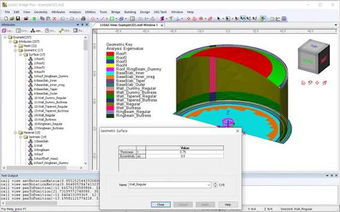
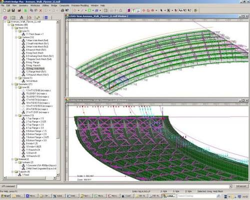

# LUSAS Structural Models With Traceable Analysis Decisions

A bridge assessment can change when a bearing restraint, construction stage, or section assignment changes.
LUSAS brings geometry, finite element modelling, analysis, and results processing into a Modeller and Solver workflow.
This guide follows the decisions that make a calculation understandable, with official LPI examples linked beside the relevant task.

## Decide what should be automated

Use the graphical model to establish the physical assumptions before turning repeated operations into scripts.
LUSAS Programming Interface automation is useful when geometry, assignments, or reporting must be repeated consistently.

Choose an automation boundary:
- Repeated geometry with a fixed modelling approach.
- Attribute assignment to a defined collection of objects.
- Consistent extraction of results from comparable analyses.
- Parameter studies whose inputs and acceptance checks are recorded.

[01_Connect_to_LUSAS.py](python/01_Connect_to_LUSAS.py) introduces the connection to Modeller.
For a Windows environment with LUSAS 23.0 and pywin32 available, this connection check writes a project-specific log message:

```python
import win32com.client as win32

modeller = win32.dynamic.Dispatch("Lusas.Modeller.23.0")
modeller.setVisible(True)
modeller.enableUI(True)
modeller.getTextWindow().writeLine("Bridge review: automation connection checked")
```

Match the COM version identifier to the installed release.
The official example branch and the installed LUSAS version should agree.

[02_Create_New_Model.py](python/02_Create_New_Model.py) demonstrates project creation with a check for unsaved model changes.
Keep that check when adapting scripts that create another model.

[](https://lusas-fea.github.io/lusas-software/)

## Build an idealisation that can be inspected

### Geometry and object membership

Select the dimensional representation from the structural behaviour you need to resolve.
A beam model, a shell model, and a solid model answer different questions even when they describe the same structure.

The geometry examples separate the construction operations:
- [03_Point_Creation.py](python/03_Point_Creation.py) establishes point creation.
- [04_Line_Creation.py](python/04_Line_Creation.py) develops line geometry.
- [05_Surface_Creation.py](python/05_Surface_Creation.py) demonstrates surfaces.
- [06_Volume_Creation.py](python/06_Volume_Creation.py) extends geometry to volumes.

A consistent coordinate convention makes later loads and result directions easier to interpret.
Record the vertical axis, length units, and any local axis conventions alongside the model assumptions.

Object membership matters when one command acts on many features.
Use [07_ObjectSets.py](python/07_ObjectSets.py) to explore filtering and grouping model objects before applying changes.



### Attributes define the calculation

Geometry alone does not define a finite element model.
Mesh, section, material, support, and load assignments determine the calculation performed by LUSAS software.

Follow the assignment examples by the question they answer:
- Which discretisation is attached to the geometry? [10_Create_and_assign_mesh.py](python/10_Create_and_assign_mesh.py)
- Which section represents the member? [11_Create_and_assign_section.py](python/11_Create_and_assign_section.py)
- Which constitutive properties are assigned? [12_Create_and_assign_material.py](python/12_Create_and_assign_material.py)
- Which movements are restrained? [13_Create_and_assign_supports.py](python/13_Create_and_assign_supports.py)
- Where and how is the structure loaded? [14_Create_and_assign_loads.py](python/14_Create_and_assign_loads.py)

For each assignment, inspect both its definition and its target objects.
A correct material attached to the wrong region still produces the wrong model.

Use a simple reference problem before expanding the assembly.
[15_Simply_Supported_Beam.py](python/15_Simply_Supported_Beam.py) provides a concrete beam example for following the modelling sequence.
Check expected reactions and displacement trends before transferring the approach to a larger structure.

## Organise analysis cases before comparing answers

LUSAS FEA includes linear and nonlinear structural analysis, dynamics, thermal analysis, and staged construction capabilities.
The required analysis options depend on the engineering problem and the licensed product configuration.

Keep three questions separate:
1. What loading and boundary conditions define this case?
2. What analysis assumptions govern the solution?
3. What combination or envelope is needed for interpretation?

[20_Create_and_Run_Analyses_and_Loadcases.py](python/20_Create_and_Run_Analyses_and_Loadcases.py) demonstrates analyses, loadcases, and solution operations.
[21_Create_Combinations_and_Envelopes.py](python/21_Create_Combinations_and_Envelopes.py) addresses how existing loadcases are combined or enveloped.

A linear combination assumes the underlying response can be superposed.
For nonlinear behaviour or construction history, establish a suitable analysis sequence instead of assuming that separate responses can simply be added.

### Keep thermal coupling explicit

Temperature effects may require thermal results to inform a structural calculation.
[22_Coupled_Structural_Thermal_Analysis.py](python/22_Coupled_Structural_Thermal_Analysis.py) illustrates a coupled workflow with stated model prerequisites.

Record the reference temperature and the intended transfer of thermal effects.
Check that the structural restraints represent the expansion or contraction that is physically possible.

### Read solver progress as evidence

A completed run still needs an engineering review.
Warnings, convergence behaviour, and unexpected response changes can reveal assumptions that deserve another check.

[102 Solver Output Monitoring.py](python/Tools/102%20Solver%20Output%20Monitoring.py) visualises information from a specified solver log.
Configure the log location for the calculation being reviewed.

| Observation | First investigation | Evidence to retain | Next comparison |
|---|---|---|---|
| Excessive displacement | Restraints, stiffness, and units | Displaced shape and input assumptions | A simple reference estimate |
| Local stress peak | Load introduction and geometric detail | Contours with mesh context | Results after local refinement |
| Nonlinear convergence difficulty | Increments and changing structural response | Solver messages and response history | A justified increment adjustment |
| Unexpected thermal movement | Temperature definition and restraints | Temperature field and support layout | A free-expansion estimate |

## Use bridge parameters with a defined scope

LUSAS Bridge supports bridge analysis, design, and assessment workflows.
A parametric bridge model is most useful when its assumptions and parameter limits are visible to the engineer reviewing it.

[412 Free Cantilever Method model.py](python/Parametric_Models/412%20Free%20Cantilever%20Method%20model.py) demonstrates bridge generation through the FCM wizard using JSON input.
Its comments identify version requirements for particular data export operations.
Check those requirements before incorporating them into another workflow.

[501 Bridge Abutment.py](python/Parametric_Models/501%20Bridge%20Abutment.py) describes a two-dimensional abutment model with editable geometry inputs.
The example adopts a soil material model and explicitly omits interfaces and joints.
Decide whether those assumptions suit the interaction being investigated before changing dimensions.

For staged construction, document:
- The structural system active at each stage.
- The timing of support and element changes.
- The load history carried into later stages.
- The response quantities used to compare alternatives.



## Make result extraction answer a specific question

Select the analysis, loadcase, result component, and coordinate system before exporting values.
Record whether the values are nodal, elemental, averaged, or taken at another result location.

For direct extraction, [30_Getting_Results.py](python/30_Getting_Results.py) introduces nodal and element result access.
For a reporting workflow, [31_Getting_Results_PRW.py](python/31_Getting_Results_PRW.py) uses the Print Results Wizard.

### Inspect assignments before explaining response

A section audit can help explain why two nominally similar members respond differently.
[18_Extract_Geometric_Properties.py](python/18_Extract_Geometric_Properties.py) demonstrates geometric property extraction.

With the supplied Python directory available and an existing model open, this short LPI check lists lines with geometric assignments:

```python
from shared.LPI import get_lusas_modeller

modeller = get_lusas_modeller()
if not modeller.existsDatabase():
    raise RuntimeError("Open the model to audit first.")
for line in modeller.database().getObjects("Line"):
    if line.getAssignments("Geometric"):
        print(f"Line {line.getID()}: geometric assignment present")
```

This checks assignment presence; the full example goes further into section properties.
Confirm section dimensions and orientations when a response differs from the reference calculation.

### Distinguish derived values from extracted values

[32_User_Defined_Results_and_Design_Attributes.py](python/32_User_Defined_Results_and_Design_Attributes.py) demonstrates formula-based results and design attributes.
Keep the formula, its input quantities, and the chosen units with any derived result.

For section cuts, [33_Getting_Results_2D_Slice.py](python/33_Getting_Results_2D_Slice.py) integrates results along a slice to obtain resultants and moments.
The example states prerequisites for the model, selected line, and solved active loadcase.
It also notes that variable transverse thickness is not accounted for in axisymmetric models.

## Example scope and product context

The linked scripts are official LUSAS LPI examples; the two Python snippets above use the connection and database interfaces demonstrated there.
They require a compatible LUSAS environment and are not standalone implementations of Modeller or Solver.
Unrelated Kratos build materials are outside this guide.
The scripts and snippets have not been executed for this document.

LUSAS is commercial software developed by Finite Element Analysis Ltd.
Its product families include Bridge, Civil & Structural, Analyst, Composite, and Academic.
The example collection supplements the product documentation; it does not provide a licence or the proprietary solver source.

## Related Search Terms

lusas fea, lusas software, lusas fem, lusas bridge, lusas finite element analysis, finite-element-analysis, finite-elements, structural-analysis, structural-engineering, bridge-engineering, modal-analysis, numerical-methods, multiphysics, python, automation
